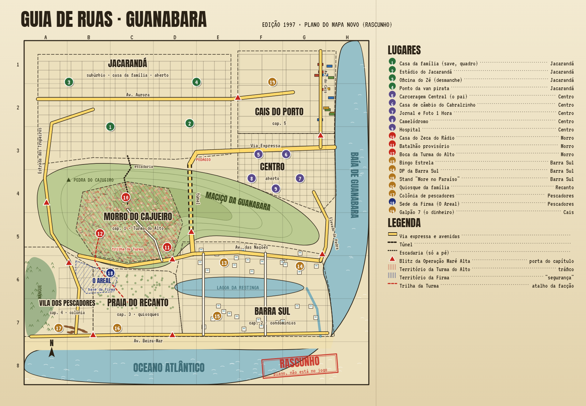

# Documento de design: Maresia 97

> Rascunho de direção do jogo (21/11/2026, 4ª versão). Nada aqui está implementado ainda. Serve pra decidir o que construir e em que ordem.
>
> Este documento trata dos **sistemas** (mapa, economia, necessidades, investigação, escolhas). A história, cena por cena, fica no [roteiro](roteiro.md).

## O problema

O jogo tem cidade, carros, polícia, missões, empregos e comércios, mas depois de 10 a 20 minutos vira só passeio. Falta **motivo pra voltar**. Os jogos de referência prendem porque sempre existe uma meta em três escalas de tempo:

| Escala | Pergunta do jogador | Hoje no Maresia |
|---|---|---|
| Minutos | "o que eu faço agora?" | missão do orelhão, emprego |
| Dia | "o que eu preciso resolver hoje?" | nada |
| Semanas | "aonde isso vai dar?" | juntar dinheiro pro próximo bairro |

A proposta é preencher as duas linhas de baixo sem jogar fora o que já existe.

## Referências e o que pegar de cada uma

- **Watch Dogs (o 1º):** motivo pessoal e um verbo único que muda o jeito de olhar a cidade (o hacking e o *profiler*: cada pedestre tem nome e segredo).
- **Project Zomboid:** cada dia tem exigências; habilidades sobem com o uso; você monta seus equipamentos.
- **Punch Club:** gerir o dia (trabalhar, treinar, comer, descansar) a serviço de uma história de vingança, com visual simples.

## Pilares

1. **História séria, mundo estilizado.** O peso vem da escrita, das situações e das escolhas, não do gráfico. O humor carioca fica nas placas, nos nomes e no rádio, mas a trama não é piada.
2. **Investigar é o verbo principal.** Ouvir, gravar, fotografar, anotar e ligar pistas, e levar o que achou pro jornal.
3. **Todo dia é um problema pra resolver.** Comer, dormir, pagar o agiota toda sexta, e sobrar tempo pra investigar.
4. **Cada bairro aberto muda a sua vida.** Abrir um bairro traz emprego novo, coisa nova pra comprar e um degrau a mais de ganho.
5. **Prova analógica.** Em 1997 não tem celular com câmera nem nuvem. Prova é filme revelado, fita K7 gravada e papel com carimbo, e precisa ser carregada fisicamente pela cidade.
6. **O atalho sempre existe, e um dia alguém descobre.** A facção e os PMs resolvem rápido o que a família resolve devagar. O jogo não pune na hora: deixa rastros, e a conta chega numa cena.

## Por que o Rio de 1997

- A Zona Oeste vivia o auge da especulação imobiliária, com a via expressa recém-aberta encurtando o caminho até a orla e fazendo o metro quadrado explodir.
- Ainda resistiam na faixa de praia comunidades de pescadores e quiosques de madeira, antes da onda de condomínios fechados e resorts.
- A segurança pública da época era de operações de choque e discurso de "limpeza". Uma operação policial truculenta usada pra desvalorizar terrenos e expulsar moradores é totalmente verossímil.
- O tráfico já dividia os morros, e em algumas comunidades da Zona Oeste ex-policiais começavam a vender "segurança" pros moradores (o que anos depois ganhou o nome de milícia). As duas coisas cabem na história sem caricatura.

### Regra dos nomes (importante)

A cidade é **inspirada** no Rio, do mesmo jeito que a Vila Maresia era inspirada em Fortaleza:

- **Nada de nomes reais** de políticos, governos, programas de governo, jornais, rádios, delegacias, empresas ou policiais. Usamos versões inventadas que **lembram** os reais.
- **Facções inventadas, sem sigla.** Nada de nome, sigla, cor ou símbolo que lembre facção real. As do jogo têm nome de apelido de rua ("Turma do Alto", "a Firma").
- **Lugares com nomes trocados.** Bairros, avenidas e pontos famosos ganham um nome próprio do jogo. (O "Jacaré" virou **Jacarandá**: Jacaré é um bairro real do Rio, colado no Jacarezinho.)
- Ícones genéricos podem ficar (camelódromo, bingo, van pirata, frescão, orelhão, quiosque, foto 1 hora), porque não apontam pra ninguém.
- Times de futebol também são inventados.
- Antes de lançar, procurar cada nome inventado na internet. Já sabemos que **Rádio Metrópole** existe (em Salvador), então a rádio do jogo é a **Rádio Farol AM**. Falta checar Jornal da Guanabara, Bingo Estrela, BarraSul e Jacarandá.

## Premissa (resumo)

**Guanabara, 1997.** A Via Expressa furou o maciço e ligou o subúrbio do **Jacarandá** à **Barra Sul**. A **BarraSul Incorporações** quer a orla limpa pra um resort, e a **Operação Maré Alta**, do **Delegado Azevedo**, fecha os bairros com blitz pra assustar os moradores. O serviço sujo fica com a **Firma**, um grupo de ex-PMs. O tráfico do Morro do Cajueiro, a **Turma do Alto**, também apanha da operação.

Seu pai, quiosqueiro na Praia do Recanto há 30 anos, foi preso com um flagrante plantado. A família ficou devendo a um agiota. Você volta pra casa pra tirar seu pai da cadeia sem pisar em ninguém. A Turma oferece um atalho; mais adiante, a polícia também. No meio está o **Cabo Peixoto**, PM do batalhão do morro que recebe da Turma e plantou o flagrante a mando da delegacia. E uma repórter do Jornal da Guanabara pode publicar o que você descobrir.

A história tem sete pontos de decisão com três saídas cada, e cada coadjuvante tem um vínculo com você que define o final dele.

Personagens, capítulos, cenas, escolhas e finais: [roteiro](roteiro.md).

## A cidade nova

*O desenho é gerado por [mapa-planejado.html](mapa-planejado.html). É um plano: o jogo ainda usa o mapa antigo.*

O mapa antigo é uma grade com o mar só no leste. Ele é **reorganizado** com a geografia do Rio, encolhida pra caber no mesmo tamanho (376 × 376 tiles):

- **Mar ao sul e baía a leste.** As praias ficam viradas pro sul, como no Rio, e o Centro e o porto ficam na beira da baía.
- **Um maciço no meio.** O Maciço da Guanabara separa o subúrbio (norte) da Barra (sul). Ninguém atravessa ele de carro, a não ser pelo túnel da Via Expressa ou pelo Elevado da Pedra, na beira da baía. Isso cria as "portas" que a blitz controla.
- **Asfalto colado no morro.** A favela do Cajueiro desce a encosta sul do maciço até a Av. das Nações, de frente pros condomínios da Barra Sul.
- **Lagoa entre a Barra e a praia.** Os condomínios ficam em volta dela; duas pontes levam à Beira-Mar.
- **Oeste esquecido.** Depois da Barra vem a Praia do Recanto (quiosques e restinga) e, no fim da estrada, a Vila dos Pescadores, no mangue, onde manda a Firma.

### Bairros

Os códigos internos ficam os mesmos, então dá pra reaproveitar o sistema de bairros e blitz.

| Código | Hoje | Vira | Inspirado em | Onde fica | Abre |
|---|---|---|---|---|---|
| `jardim` | Jardim Maresia | **Jacarandá** | Freguesia e Pechincha | norte, planície | desde o início |
| `centro` | Centro | **Centro** | Saara, Praça XV, Cinelândia | leste, na baía | desde o início |
| `cajueiro` | Alto do Cajueiro | **Morro do Cajueiro** | Rocinha e morros de Jacarepaguá | encosta sul do maciço | fim do capítulo 1 |
| `rico` | Alto da Maresia | **Barra Sul** | Barra da Tijuca | sul, em volta da lagoa | fim do capítulo 2 |
| `orla` | Orla | **Praia do Recanto** | Recreio e Reserva | sudoeste, praia e restinga | fim do capítulo 3 |
| `velha` | Vila Velha | **Vila dos Pescadores** | Guaratiba e Pontal, Rio das Pedras | extremo oeste, mangue | fim do capítulo 4 |
| `porto` | Porto | **Cais do Porto** | Gamboa e zona portuária | nordeste, na baía | fim do capítulo 5 (e já dá pra trabalhar lá de noite no capítulo 5) |

Enquanto o capítulo de um bairro está ativo, dá pra entrar a pé pelo caminho do capítulo (veja abaixo), mas os empregos e as lojas de lá só funcionam de verdade depois que a blitz cai.

### Vias

| Via | Liga | Inspirada em | Papel |
|---|---|---|---|
| **Via Expressa** | Centro → Jacarandá → túnel → Barra Sul | Linha Amarela | a espinha da cidade; praça de pedágio na boca norte do túnel |
| **Av. das Nações** | Morro → Barra Sul (pé do morro) | Av. das Américas | separa a favela dos condomínios |
| **Av. Beira-Mar** | Pescadores → Recanto → Barra Sul | orla do Recreio | a praia inteira |
| **Elevado da Pedra** | Centro → Barra Sul (beira da baía) | Elevado do Joá | o outro jeito de chegar na Barra |
| **Estrada dos Tropeiros** | Jacarandá → contorna o maciço → Pescadores | Estrada dos Bandeirantes | a rota das vans da Firma |
| **Av. Aurora** | Jacarandá → Cais | Av. Brasil | caminhão, ônibus e frescão |
| **Av. do Cais** | Cais → Centro | Av. Rodrigues Alves | o porto |
| **Estrada do Cajueiro** | Av. das Nações → meio do morro | — | a única rua que sobe o morro (de carro só pelo asfalto da Barra) |
| **Escadaria** | Jacarandá → alto do morro | — | só a pé, pelo alto do maciço |

### Como se entra em cada capítulo

As blitz ficam onde uma rua cruza a borda do bairro fechado (é assim que o código já funciona):

| Bairro | Blitz (carro) | Entrada do capítulo (a pé) |
|---|---|---|
| Morro do Cajueiro | Estrada do Cajueiro (que só sai na Barra, também fechada) | a **escadaria** do Jacarandá |
| Barra Sul | saída do túnel da Via Expressa e o Elevado da Pedra | de carona no frescão do bingo, ou pelo morro descendo a Estrada do Cajueiro |
| Praia do Recanto | Av. das Nações e Beira-Mar, na divisa com a Barra | pela areia, ou pela **trilha da Turma** (atalho da facção) |
| Vila dos Pescadores | Estrada dos Tropeiros e Beira-Mar | de barco a partir do Recanto |
| Cais do Porto | Av. Aurora e Av. do Cais | dentro de um caminhão de carga |

## O essencial em todo lugar, o novo em cada desbloqueio

### O essencial

Em qualquer bairro aberto o jogador consegue se virar. Todo bairro tem pelo menos:

| Necessidade | Jacarandá | Centro | Morro | Barra Sul | Recanto | Pescadores | Cais |
|---|---|---|---|---|---|---|---|
| **Comer** | padaria, mercadinho, feijão da mãe | lanchonete, PF do Saara | birosca | praça de alimentação do shopping (caro) | quiosques | peixaria | marmitaria do cais |
| **Dormir e salvar** | casa da família | pensão (paga a noite) | sofá do Zeca | flat (caro) | rede no quiosque da família (depois de reaberto) | casa da colônia | pensão do cais |
| **Curar** | farmácia | hospital público, farmácia | posto de saúde comunitário | hospital particular (caro, sem fila) | posto salva-vidas (curativo) | farmácia da colônia | farmácia |
| **Ligar** | orelhão | orelhão | orelhão | orelhão | orelhão | orelhão | orelhão |
| **Ganhar dinheiro** | 2 empregos | 2 empregos | 2 empregos | 2 empregos | 2 empregos | 2 empregos | 2 empregos |

Dormir longe de casa não conta como visita à família (veja "Rastros e descobertas").

### Empregos característicos

Cada bairro tem os seus. Os empregos que já existem no jogo (táxi, motoboy, busão, guincho, vigilante) ficam no bairro onde fazem mais sentido.

| Bairro | Emprego | Como funciona | Já existe? |
|---|---|---|---|
| Jacarandá | **Motoboy** da lanchonete | entregas no subúrbio | sim |
| Jacarandá | **Van pirata** Jacarandá–Centro | pega passageiro no ponto, cobra na porta, foge do fiscal de transporte (não dá estrela, mas multa e apreende a van) | variação do busão |
| Centro | **Taxista** | corridas pela cidade aberta | sim |
| Centro | **Camelô** no camelódromo | compra muamba do fornecedor e revende na barraca, de olho no rapa | novo |
| Centro | **Office-boy** | leva documentos entre cartório, banco e escritórios a pé, contra o relógio. Às vezes um documento vira pista | novo |
| Morro | **Mototáxi** | sobe e desce o morro levando morador; becos estreitos, ladeira | variação do motoboy |
| Morro | **Técnico de rádio e TV** com o Zeca | conserta aparelhos dos moradores; sobe a habilidade Eletrônica | novo |
| Barra Sul | **Manobrista** do Bingo Estrela | estaciona carros de luxo sem arranhar; gorjeta alta; ouve conversa | novo |
| Barra Sul | **Vigilante** de condomínio | turno da noite na guarita | sim (vigilante) |
| Barra Sul | **Guincho** na Via Expressa | reboque de carro enguiçado no túnel e no pedágio | sim |
| Recanto | **Ambulante de praia** | vende mate e biscoito de polvilho na areia; anda muito, ganha por venda | novo |
| Recanto | **O quiosque da família** | renda de todo dia; precisa de estoque e de você aparecer | novo |
| Pescadores | **Pesca** | sai de barco antes de clarear, volta com o peixe e vende na peixaria | novo |
| Pescadores | **Frete de peixe** | leva o peixe da colônia pro Centro de caminhonete, antes de estragar | novo |
| Cais | **Estivador** | carrega e descarrega contêiner com empilhadeira, turno da noite | novo |
| Cais | **Caminhoneiro** | frete longo pela Av. Aurora; carga às vezes suspeita (vira pista ou problema) | novo |
| Cidade toda | **Busão** | as linhas crescem conforme os bairros abrem | sim |

Os empregos de facção (olheiro, aviãozinho, "segurança" da Firma) **não** são empregos: são favores da história, com rastro (veja abaixo).

### Níveis de ganho

Cada desbloqueio sobe um degrau de quanto dá pra ganhar, mas pede alguma coisa em troca (horário ruim, risco, aparência, licença). Valores por hora do jogo de trabalho focado, no nível 1 (os níveis de emprego que já existem multiplicam até 2×):

| Degrau | Bairros | Ganho por hora | O que pede |
|---|---|---|---|
| 1 | Jacarandá, Centro | $60–100 | nada; é o que dá pra fazer no primeiro dia |
| 2 | Morro, Recanto | $80–130 | habilidade (Eletrônica, no Zeca) ou estoque (quiosque, ambulante) |
| 3 | Barra Sul, Pescadores | $120–200 | aparência (roupa boa pra trabalhar na Barra) ou horário ruim (pesca antes de clarear) |
| 4 | Cais | $200–300 | turno da noite e risco (carga suspeita, Firma de olho) |

Pra o dinheiro continuar importando, as despesas também sobem com a história:

- a parcela do Cabralzinho;
- a multa da interdição do quiosque (capítulo 3);
- os subornos de cada capítulo;
- o equipamento de investigação;
- e, mais tarde, carro próprio e garagem.

### O que comprar em cada lugar

| Bairro | O que tem de novo |
|---|---|
| Jacarandá | o básico: comida, farmácia, peças usadas na Oficina do Zé |
| Centro | componentes eletrônicos e pilhas no camelódromo, fita K7, revelação na Foto 1 Hora, roupa barata no Saara, armas na galeria do Tonhão, jornal na banca |
| Morro | peças de rádio do Zeca, "gato" de luz e de TV (barato e ilegal) |
| Barra Sul | roupa boa no shopping (aparência), câmera e gravador melhores, concessionária (o primeiro carro próprio), apostas no bingo |
| Recanto | estoque do quiosque (atacado), prancha e bicicleta |
| Pescadores | peixe barato, material de pesca, um barco usado (transporte pela água entre Recanto, Pescadores e Cais) |
| Cais | contrabando importado (eletrônicos baratos e de origem duvidosa), caminhão usado, garagem |

## O verbo principal: escuta e investigação

Tecnologia de 1997 no lugar do hacking:

- **Caderneta (fichas de pessoas).** A tecla **C** mostra a ficha de quem está perto: nome, ocupação e, às vezes, um segredo ("deve ao Cabralzinho", "vende peça roubada", "viu a prisão do seu pai", "olheiro da Turma", "paga a Firma"). Algumas pessoas viram contatos ou geram bicos. É o *profiler* do Watch Dogs.
- **Scanner de rádio.** A tecla **R** liga e desliga. Ouve a polícia: avisa onde estão as viaturas e as blitz móveis, e às vezes solta uma pista.
- **Grampo de orelhão.** Instalado num orelhão, grava as ligações. Algumas são pistas; outras viram missões.
- **Câmera 35mm e gravador K7.** Fotografar uma pessoa ou um carro no lugar e na hora certos; gravar o áudio do scanner ou de uma conversa.
- **Revelar o filme.** Foto só vira prova depois de revelada na **Foto 1 Hora** do Centro. Você leva o filme até lá e espera (1 hora do jogo), às vezes seguido por capangas da construtora. Se te pegarem com o filme, perdem a prova.
- **Quadro de investigação** (em casa, no quarto). As pistas aparecem ligadas por barbante. Quando um grupo fecha, abre a missão do capítulo.

### O contato no jornal

Além de pagar a dívida, o que você descobre pode virar **matéria**. A repórter **Mariana**, do Jornal da Guanabara, vira seu contato no fim do prólogo (a história de como vocês se conhecem está no roteiro).

- **Encontro:** no Bar Lisboa, ao lado da redação, no Centro, de segunda a sexta das 18h às 22h. Ou por código no orelhão: você liga pra redação, ela marca hora e lugar.
- **O que ela aceita:** prova física (foto revelada, fita, documento). Ela avalia três coisas:
  - **É física?** Boato não vira matéria.
  - **É legível?** Foto tremida ou fita com chiado demais não serve.
  - **É limpa?** Prova conseguida com a ajuda da Turma ou da polícia aliada é **contaminada**: ela não publica, ou publica e a matéria cai, porque o advogado da BarraSul desmonta.
- **A matéria sai no dia seguinte.** O jornal aparece nas bancas com a manchete. Comprar e ler na banca mostra a matéria (e é o jeito de o jogador ver o efeito).
- **O que uma matéria muda:**
  - o Ronda da Cidade muda de tom no rádio;
  - a operação recua no bairro do capítulo (menos viaturas, blitz mais frouxa);
  - o caso do pai anda: um defensor público aceita o caso depois da primeira matéria e consegue visita fora do horário depois da segunda;
  - a reação: o Azevedo manda dar uma batida na casa da família ou seguir você por um dia.
- **Freela:** foto que ela usa e não é do caso rende um pagamento pequeno (acidente na Via Expressa, incêndio, flagrante de fiscal). É mais um bico, e treina o uso da câmera.
- **Pro final "A matéria"** (veja o roteiro) é preciso ter publicado pelo menos três matérias limpas até o capítulo 5.

## Decisões, vínculos e descobertas

### Pontos de decisão

A história tem **sete pontos de decisão**, um ou dois por capítulo (a lista e o que cada saída faz estão no [roteiro](roteiro.md#como-a-história-se-monta)). Em cada um:

- **Três saídas**, sempre: em geral uma limpa, uma pela Turma e uma pela polícia ou pela Firma. Às vezes uma das saídas só aparece se você tem o que ela pede (uma matéria publicada, o Peixoto na mão, vínculo alto com alguém).
- **A tela de decisão** é uma cena de diálogo no estilo do HUD 97: quem fala, a proposta e as três respostas. A decisão não tem tempo pra responder (em aberto se alguma deveria ter).
- **Cada saída muda três coisas:** o que acontece na hora (a próxima cena, o que abre e o que fecha), os vínculos com os coadjuvantes e uma **marca** que o final lê.
- **O jogo não diz o que vai acontecer no final**, só o que acontece na hora. Depois da decisão, a caderneta anota numa página "O que eu fiz" (uma linha por decisão, escrita do jeito do protagonista).

### Vínculos

Cada coadjuvante tem um **vínculo** com você, de 0 a 5, que aparece na caderneta como marquinhas ao lado da foto. São oito: o pai, a mãe, o Juninho, o Neném, o Zeca, a Mariana, o Cabo Peixoto e o Seu Jurandir (presidente da colônia).

- **Sobe** com os **pedidos pessoais** (cada um tem dois ou três pequenos pedidos ao longo do jogo, listados no roteiro), com **presença** (visitar, aparecer, cumprir o combinado) e com decisões que ajudam aquela pessoa.
- **Cai** com mentira descoberta, promessa quebrada e decisões contra ela.
- **Define o final de cada um.** Depois do final da história, cada coadjuvante ganha um epílogo escolhido pelo vínculo (alto, médio ou baixo) e por uma ou duas decisões (tabelas no roteiro).
- **Também muda o jogo no meio do caminho.** Vínculo alto com o Neném abre uma conversa antes da guerra; com a Mariana, ela banca matéria arriscada; com o pai, as visitas dão pistas. Na família, o vínculo muda a casa:

| Vínculo | Mãe (em casa) | Pai (nas visitas) | Juninho |
|---|---|---|---|
| Alto (4–5) | feijão no fogão, ajuda a esconder prova, empresta dinheiro numa sexta apertada | conta tudo que lembra; as visitas dão pista | fica em casa, estuda |
| Médio (2–3) | cobra explicação, o feijão vem com sermão | desconfia, conta menos | fica na rua até tarde |
| Baixo (0–1) | tranca o quarto: você não guarda nada em casa e o quadro de pistas vai pro Zeca | se recusa a receber você | some de casa (veja abaixo) |

### Rastros

A família não fica sabendo aos poucos, sem ver. **O que você faz deixa rastros, e em algum momento alguém descobre.** O vínculo com a família só muda em cenas: quando alguém descobre, quando você conta, quando cumpre ou quebra uma promessa.

Cada favor pra facção ou pros PMs deixa um ou mais rastros. O jogo guarda cada um:

| Rastro | Como aparece | Como esconder |
|---|---|---|
| **Coisa em casa** (mochila, arma, dinheiro alto) | guardada no guarda-roupa | guardar no Zeca, num guarda-volumes da rodoviária ou entregar logo |
| **Dinheiro sem explicação** | pagar a parcela no mesmo dia em que recebeu de favor; comprar coisa cara de repente | trabalhar num emprego visível antes de gastar |
| **Ser visto** | entrar na boca da Turma ou na DP pela porta dos fundos com gente do bairro olhando (a vizinha Dona Cida, os conhecidos da caderneta) | ir de noite, usar outra entrada, mandar recado por terceiro |
| **Juninho** | ele te segue quando está com saudade ou curioso, e vê | deixar ele ocupado, levar junto num emprego |
| **Notícia** | o Ronda da Cidade fala de "jovem do Jacarandá" depois de uma ação grande | — |

### Descobertas

Uma descoberta é uma **cena**, não uma barra caindo. Ela mexe no vínculo de quem descobriu (a mãe, o pai, o Juninho ou até a Mariana). Acontece quando um rastro é achado:

- **Coisa em casa:** cada dia que fica em casa, a chance de a mãe achar sobe (ela arruma o quarto às quartas e sábados).
- **Ser visto:** a vizinha conta pra mãe em até dois dias.
- **Juninho:** ele guarda segredo uma vez e cobra alguma coisa; da segunda vez, conta.
- **Notícia:** o pai ouve na cadeia, e a próxima visita já começa diferente.

Na cena, você escolhe:

| Escolha | Na hora | Depois |
|---|---|---|
| **Mentir** (Lábia) | se passar, ninguém perde vínculo | o rastro fica e a próxima descoberta custa o dobro |
| **Contar a verdade** | o vínculo de quem descobriu cai 1 | abre a opção de prometer sair |
| **Prometer sair** | o vínculo cai 1, e a promessa fica anotada na caderneta | se você aceitar outro favor, a promessa quebrada custa 2 de vínculo com a família inteira |

### O Juninho e os dois lados

O irmão mais novo é o termômetro das suas escolhas. O que acontece com ele depende de **com quem** você se envolve:

- **Com a Turma:** ele te admira e copia. Começa a subir o morro, vira olheiro, e se você for fundo ele entra pra Turma.
- **Com os PMs (o Azevedo ou a Firma):** a Turma descobre que tem X9 no Jacarandá e cobra no ponto fraco: **chama o Juninho**. Primeiro com dinheiro e tênis novo, depois com "trabalho". Não é admiração, é garantia: com o Juninho dentro, você não entrega ninguém.
- **Com ninguém:** o Juninho ainda é tentado (o morro paga mais que qualquer bico de 15 anos), mas a família segura, e no capítulo 4 você pode tirar ele de vez.

Os detalhes de cada caminho estão no [roteiro](roteiro.md#o-juninho).

## O dia

O tempo já passa (um dia do jogo dura 12 minutos reais) e já existe dia e noite. Entram exigências leves e os **dias da semana**:

- **Fome:** come em qualquer lugar da tabela do essencial. Com fome, a pontaria e o fôlego caem.
- **Sono:** dorme em casa ou num dos lugares de dormir. Cansado, o carro fica mais difícil de controlar e a visão escurece nas bordas.
- **Sexta-feira:** o Cabralzinho cobra a parcela na casa de câmbio do Centro. Pagar em dia mantém a paz. Atrasar traz juros, capangas e pistas fechadas.
- **Família:** visitar o pai (dias de visita) e aparecer em casa. Não é obrigatório, mas é o que mantém a família do seu lado nas descobertas.
- **O quiosque** (depois do capítulo 3): abre de dia e rende dinheiro.

O dia fica dividido entre **ganhar dinheiro**, **cuidar de si**, **cuidar da família** e **investigar**. Não dá pra fazer tudo: escolher é o jogo. E a facção e os PMs estão sempre ali oferecendo tempo e dinheiro.

### O rádio do carro

Ao dirigir, a **Rádio Farol AM** toca boletins de trânsito (engarrafamento na Via Expressa, pedágio parado) e notícias da Operação Maré Alta. O tom muda com as matérias do jornal: no começo o Ronda da Cidade elogia a "limpeza na orla"; a cada matéria publicada aparecem dúvidas, e no fim o próprio programa cobra o delegado.

### Dificuldade (escolhida ao começar um jogo novo)

| | Tranquilo | Normal | Raiz |
|---|---|---|---|
| Fome e sono | bem lentos, só avisam | atrapalham | atrapalham muito |
| Agiota | aceita atraso | juros e capangas | juros altos, pode tomar o quiosque |
| Morrer | perde parte do dinheiro | perde dinheiro e o dia | perde dinheiro, equipamento e o dia |
| Ferimentos | curam sozinhos | precisam de farmácia | precisam de hospital e repouso |
| Rastros | demoram a ser achados | normal | a família acha rápido e a vizinha vê tudo |

## Progressão

1. **História:** capítulos e bairros, a meta de semanas.
2. **Economia:** cada bairro aberto traz empregos, compras e um degrau de ganho (tabelas acima).
3. **Habilidades que sobem com o uso:**
   - Direção, Briga e Pontaria;
   - Lábia, que abre opções nas conversas, barateia subornos e ajuda a mentir nas descobertas;
   - Mecânica, que melhora conserto e desmanche e rende mais peças;
   - Eletrônica, que permite montar e melhorar o scanner e o grampo.
4. **Equipamento montado:** a Oficina do Zé desmancha carros e as peças sobram. Com peças, componentes (do camelódromo) e Eletrônica, você monta e melhora o scanner, o grampo, a câmera e o bip (pager que recebe dicas dos contatos).
5. **O quiosque da família:** reformar, contratar ajudante e ampliar.
6. **Vínculos:** os coadjuvantes com vínculo alto abrem ajuda, serviços e descontos (o Zeca monta equipamento mais barato, a Mariana banca matéria arriscada, o Peixoto avisa das batidas), e cada um ganha o seu final.
7. **Contatos:** gente da caderneta que vira aliada (o mecânico, um defensor público, vendedores) e abre serviços e descontos.

## O que muda nos sistemas que já existem

| Sistema | Hoje | Vira |
|---|---|---|
| Mapa | grade com mar a leste, bairros retangulares | mapa novo com mar ao sul, baía, maciço, lagoa e mangue |
| Blitz dos bairros | abre com meta de dinheiro | abre ao terminar o capítulo do bairro |
| Orelhões | missões avulsas | ligações de contatos, da Mariana, da Turma e da história; alguns aceitam grampo |
| Oficina do Zé | desmanche por dinheiro | desmanche por dinheiro **e peças** |
| Empregos | 5 empregos em qualquer lugar | 2 por bairro, com degraus de ganho (os 5 atuais continuam) |
| Comércios | os mesmos em todo lugar | o essencial em todo lugar e coisa nova em cada bairro |
| Casa | salvar e dormir | dormir passa a noite, tem o quadro de pistas e o feijão da mãe. É onde as descobertas acontecem |
| Delegacia do Centro | fiança | vira a Carceragem Central: fiança e visita ao pai |
| Polícia e estrelas | procurado | igual, mas o scanner ajuda e a operação reage às matérias |
| Estádio (hoje Arena Maresia) | jogo às 15h30 | Estádio do Jacarandá, com times inventados |

### O que muda no código do mapa

- **Gerador do mapa reescrito** (`world/map.js` e `world/zoning.js`): mar ao sul e baía a leste, o maciço como área sem ruas (verde, pedra e mata), a lagoa, o mangue, a favela com becos tortos e as vias acima. Os bairros deixam de ser retângulos e passam a seguir o desenho.
- **O maciço é plano no 3D**, como o resto do mapa: verde mais escuro, pedras e árvores. A escadaria e as ruas do morro sugerem a subida. Relevo de verdade fica pra depois.
- **Saves antigos:** as posições não valem mais (como na 1.8.0). Quem carrega um save antigo acorda em casa, no Jacarandá, com o dinheiro e os níveis de emprego, e começa a história no prólogo.
- Primeiro entra a geometria e os nomes; a decoração própria de cada bairro vem junto do capítulo dele (vila com caquinho no Jacarandá, sobrados e camelódromo no Centro, lajes e caixas d'água no morro, condomínios e o neon do bingo na Barra, quiosques e restinga no Recanto, barcos e redes na colônia, guindastes e contêineres no Cais).

## Primeira fatia jogável: "Semana 1"

Objetivo: testar se a ideia segura o jogador antes de construir tudo. Cobre o prólogo e o capítulo 1 do [roteiro](roteiro.md), numa semana do jogo (de domingo 16h30 a sexta 20h, uns 60 minutos reais no Normal). Os números são ponto de partida pra calibrar jogando.

### 0. O mapa novo

A Semana 1 já acontece no mapa novo. Primeiro entra a geometria inteira com os nomes novos, sem a decoração de cada bairro. Só o Jacarandá, o Centro e o Morro do Cajueiro precisam estar redondos, cada um com o essencial (comer, dormir, curar, orelhão) e os seus dois empregos.

### 1. Jogo novo e dificuldade

- Na tela de título, "Jogo novo" abre a escolha **Tranquilo / Normal / Raiz**, com uma linha explicando cada uma. Normal vem marcado.
- A dificuldade fica gravada no save e não muda no meio do jogo.
- O jogo começa num **domingo, 16h30**, na porta da casa no Jacarandá. O tutorial atual continua, com as falas trocadas pra história.

### 2. Dias da semana

- O relógio do HUD mostra o dia: **DOM 16:30**. O pager avisa "Sexta: parcela do Cabralzinho" na quinta e na sexta de manhã.
- O jogo já conta dias (`S.day`); falta mostrar o nome do dia e usar isso nas regras.

### 3. Fome e sono

Duas barras pequenas embaixo da vida, no estilo do HUD 97. De 100 (bem) a 0.

| | Tranquilo | Normal | Raiz |
|---|---|---|---|
| Fome cai de 100 a 0 em | 3 dias do jogo | 1,5 dia (18 min reais) | 1 dia |
| Sono cai de 100 a 0 em | 4 dias | 2 dias | 1,5 dia |
| Abaixo de 30 | só aviso | efeito leve | efeito forte |
| Em 0 | só aviso | perde vida devagar (fome) ou desmaia e acorda no lugar de dormir mais perto às 7h (sono) | idem, mais rápido |

- **Comer:** a comida que já existe passa a encher a fome além da vida (marmita, X-tudo e café da manhã enchem bastante; cafezinho e água, pouco). O **feijão da Dona Tereza** é de graça, uma vez por dia.
- **Dormir:** a cama de casa passa a noite até 7h, enche o sono e salva. Dormir de dia descansa 4 horas.

### 4. A dívida e a sexta-feira

- Dívida inicial de **$5.000**, parcela de **$500** por semana, paga na casa de câmbio do Centro até as **20h de sexta**.
- Um dia de trabalho focado no degrau 1 rende mais ou menos uma parcela.
- **Atrasou (Normal):** a parcela sobe 20% e, no sábado, dois capangas aparecem perto de casa. **Tranquilo:** aceita atraso com bronca. **Raiz:** juros de 40% e os capangas vêm na sexta à noite.
- **Sem dinheiro:** ele oferece um "favor" (entregar um envelope fechado). Paga a semana, mas vira uma pista de que o agiota trabalha pra BarraSul.

### 5. Empregos novos da Semana 1

A **van pirata** (Jacarandá), o **camelô** (Centro) e o **mototáxi** (Morro, depois do capítulo 1). Os outros empregos novos entram com os bairros deles.

### 6. Caderneta (tecla C)

- Perto de um pedestre, **C** abre uma ficha pequena no canto: **nome**, **ocupação** e, em cerca de 1 a cada 10, um **segredo**.
- Os segredos geram bicos simples.
- Personagens fixos têm ficha escrita à mão.
- A caderneta tem também a página de **pistas** do capítulo, a página **Pessoas** (foto e vínculo de cada coadjuvante, e as promessas feitas) e a página **O que eu fiz** (as decisões).

### 7. Rastros e a primeira descoberta

- Na Semana 1 só existe um rastro possível: a **mochila do Neném** (o atalho do capítulo 1, no roteiro).
- A mãe acha a mochila na quarta ou no sábado, se ela ainda estiver em casa. A cena de descoberta tem as três escolhas (mentir, contar, prometer).
- Se a mochila foi guardada no Zeca, quem descobre é o Juninho, que viu você subir com ela.

### 8. O contato no jornal

- A Mariana aparece no prólogo (roteiro) e dá o cartão.
- No fim do capítulo 1, a confissão do PM (se for limpa) vira a **primeira matéria**. O jornal sai no sábado e o Ronda da Cidade muda de tom pela primeira vez.

### 9. Prólogo e capítulo 1

Cena por cena no [roteiro](roteiro.md#prólogo-a-chegada).

### 10. Saves antigos

Quem tem save do mapa antigo acorda em casa, no Jacarandá, no domingo da Semana 1, com o dinheiro e os níveis de emprego. Os bairros voltam a fechar, porque agora abrem pela história.

### Como saber se funcionou

Jogando do zero, depois de 30 minutos ainda existe uma meta clara pro dia (a sexta chegando, uma pista pendente) e vontade de ver o próximo capítulo. A oferta do Neném deve dar vontade de aceitar e medo de ser descoberto. Testar com pelo menos duas pessoas que não conhecem o jogo.

### Fora da Semana 1

Câmera e revelação do filme, gravador K7, grampo, habilidades novas, peças e montagem de equipamento, quiosque, os empregos dos outros bairros, a Firma e o caminho dos PMs. Entram nos capítulos seguintes.

## Em aberto

- Nome da cidade (Guanabara é a proposta) e se o jogo continua se chamando Maresia 97.
- Nome e gênero de quem você joga (ou deixar escolher).
- Nome do deputado e da cara da BarraSul.
- Até onde vai o modo Raiz (perder o quiosque? morte permanente?).
- O que acontece com as missões avulsas atuais (viram bicos de contatos ou saem).
- Relevo de verdade no maciço e no Morro do Cajueiro.
- Checar na internet os nomes que faltam (Jornal da Guanabara, Bingo Estrela, BarraSul, Jacarandá).
